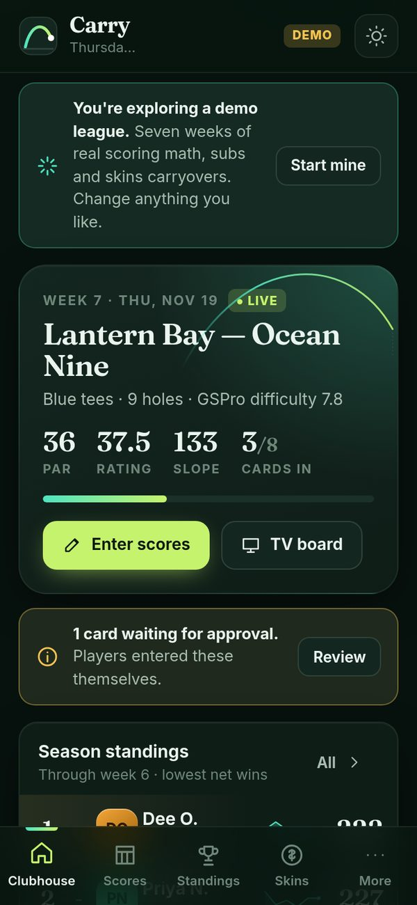
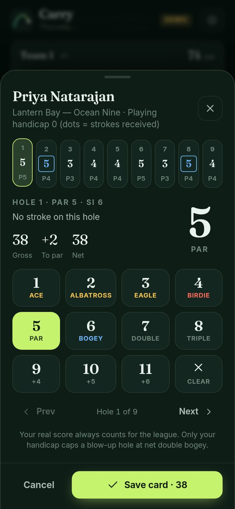
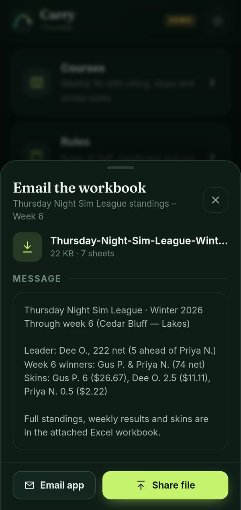
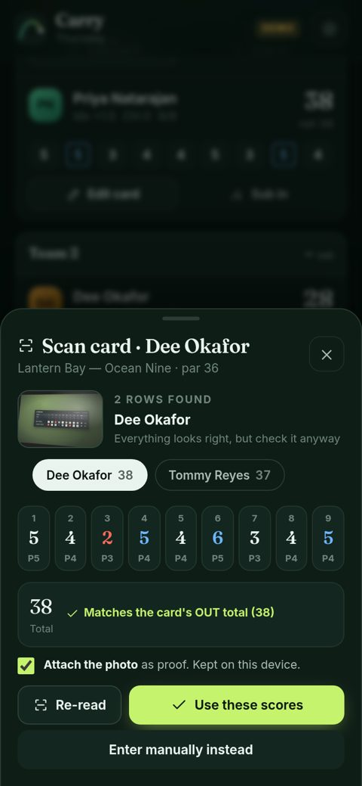
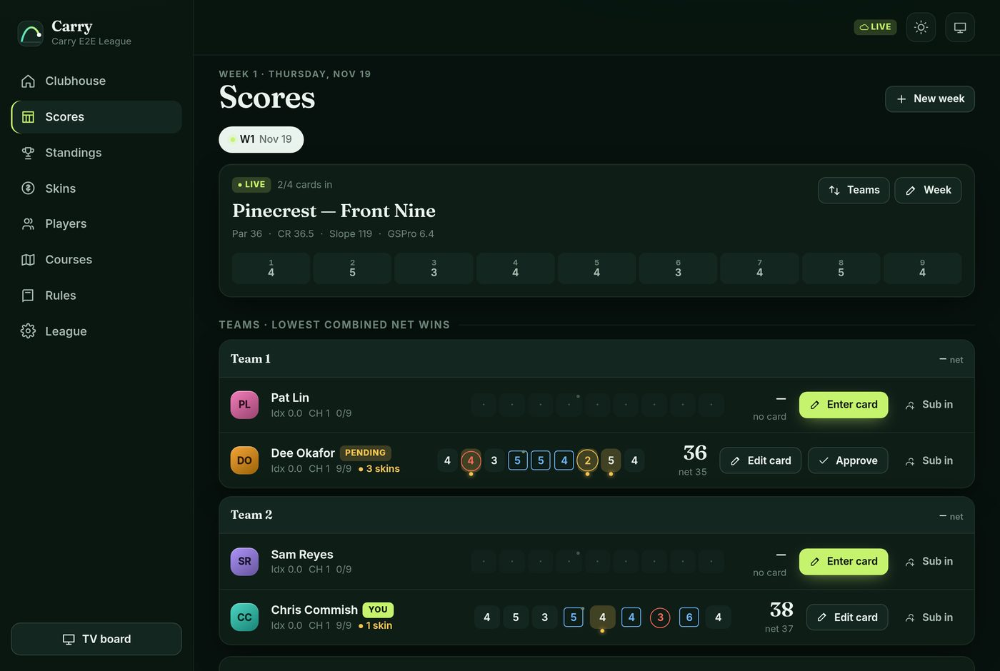
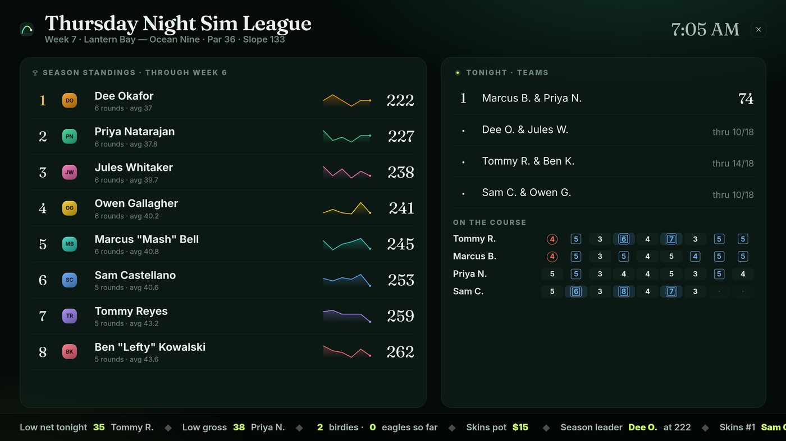

# Carry ⛳ — a 9-hole golf league tracker

**▶ Live app: <https://williams37.github.io/carry-golf-league/>**, with a demo league one tap from the sign-in screen.

<p>




</p>




A mobile-first web app for a weekly indoor (GSPro) league. Players sign in, claim their spot from an invite link, and enter their own hole-by-hole cards, and every screen updates live. A full demo league runs offline, one tap from the sign-in screen.

**What it does**

| | |
|---|---|
| **Weekly scoring** | Hole-by-hole cards with a thumb-sized score pad, classic scorecard notation (circles for birdies, squares for bogeys) and stroke dots |
| **Scan the card** | Snap the bay screen at the end of the round and Carry reads the hole-by-hole scores **on the phone** (free, no API keys, no upload to read). It picks your row by name on multi-player cards, flags holes to double-check, checks the sum against the card's OUT total, and never saves until you tap Save. The photo can be attached as proof: private to the league in cloud mode, on-device in local mode |
| **Handicaps** | WHS-style 9-hole league index: starts at 0 (or a set value), calculated after 4 rounds, updated weekly, net-double-bogey capped, every number explained |
| **Teams** | Rotating 2-player teams. Auto-rotate avoids repeat partners (a full round-robin: 7 weeks with 8 players) and then balances handicaps. Tap two players to swap them |
| **Standings** | Lowest cumulative net, regulars only, fair absence handling, season-replay scrubber with animated reordering |
| **Skins** | Gross or net, carryovers, buy-in pot and payouts, carry-chain visualization, season money |
| **Subs** | One-off substitutes with a temporary index. They count for the team, can win skins, never appear in standings, and are labeled SUB everywhere |
| **Excel** | One-click formatted workbook: Summary, Players, Courses, Weekly Results, Individual Standings, Team Results, Skins |
| **Email** | Next to every Excel button. On phones and Windows Chrome/Edge it opens the share sheet with the workbook attached. Elsewhere it downloads the file and opens your email app with the subject and a summary (leader, week winners, skins) filled in. Commissioners of cloud leagues can pick recipients from the members |
| **Rules** | Searchable plain-English guide to the Rules of Golf (2023 edition), WHS basics, simulator house rules, and this league's own rules generated from its settings |
| **TV board** | Full-screen rotating leaderboard, live cards, skins track and a ticker for the sim-room TV |
| **PWA** | Installable and offline-capable. Dark and light themes |

## Run it locally

```bash
npm install
npm run dev          # http://localhost:5173
npm test             # vitest: handicap, NDB, rotation, standings, skins, subs, Excel
npm run build        # dist/ (PWA) + dist-single/index.html (one self-contained file)
```

`dist-single/index.html` is the whole app in one file (≈1.6 MB, mostly the Excel engine). Double-click it and it runs from disk, with data saved in that browser.

## Carry Cloud (live now)

This build is wired to the Supabase project **carry-golf-league** (ref `wneltrdjfgoxfjuvphay`, us-east-1, Free plan). Every build, including the single file, opens on cloud sign-in by default. **"Just looking? Explore the demo league"** is one tap away on that screen and runs offline on the device.

* **Sign-in:** email + password is the default. It needs no redirect URLs, so it works on any host and even from `file://`. The "Email code" tab is optional and passwordless.
* **Email confirmation:** if the project requires it, sign-up shows a **Check your email** screen with a Resend button. Signing in before confirming gives a clear "isn't confirmed yet" message with a Resend button. A confirmation link opened in another browser still confirms the account, and the app tells the player to sign in with their password.
* **Forgot password** sends a reset link. The link returns to the app, which asks for a new password.
* **Invites:** League → Invite players → **Share** or **Copy link**. A player opens `…/#/join/CODE`, signs in or creates an account, joins, and taps their name to claim it. Claimed names are greyed out for everyone else.
* **Live:** cards, approvals, new weeks and new members show up on every open screen without a refresh (Supabase Realtime).

The publishable key in `src/config.js` is meant to be public. Row-level security enforces who can do what:

* Signed-out requests see nothing. Only members of a league can read it.
* Only the commissioner can edit the league, approve cards, change members, or regenerate invites.
* A player can only write *their own claimed* card, and only as `pending`. They can't approve it, edit someone else's, switch to another player, promote themselves, or fake who entered a card.

`supabase/rls_test_live.sql` checks all of this on the live database inside a rolled-back transaction. `scripts/e2e-cloud.mjs` drives three real browsers (commissioner + two players) through the full flow (26 checks).

### Supabase dashboard settings to finish (the connector can't change these)

Open <https://supabase.com/dashboard/project/wneltrdjfgoxfjuvphay>.

1. **Let real players get email (required before inviting anyone).** Supabase's built-in mailer only delivers to members of your Supabase organization and allows about 2 emails an hour. Sign-ups from anyone else currently fail with "can't send email to this address". Pick one:
   * **Simplest:** **Authentication → Sign In / Providers → Email → turn off "Confirm email"** → Save. New players can then create an account with email + password and are signed in immediately. No email is sent, so nothing is blocked.
   * **Proper:** **Authentication → Emails → SMTP Settings → Enable custom SMTP** (for example Resend, Postmark, or a Gmail app password), then keep "Confirm email" on. This also makes the Email-code tab and Forgot password work for everyone.
2. **Authentication → URL Configuration:** set **Site URL** to `https://williams37.github.io/carry-golf-league/`. Under **Redirect URLs**, add that same URL plus `http://localhost:5173/` and `http://localhost:4173/`. This only matters for links in emails (confirmation, reset, magic link). Password sign-in works without it.
3. *(Optional, for the Email code tab)* **Authentication → Emails → Templates → Magic Link:** add `{{ .Token }}` to the body, for example `Your Carry code: {{ .Token }}`, so players can type the code instead of tapping the link.

### Hand it to Grok to publish

Give Grok the file `Carry-golf-league.html` (same as `dist-single/index.html`) with this prompt:

> Publish this file exactly as-is as a static web app. It is a complete, self-contained single-page app (React, already built and minified). Do not rewrite, re-generate, split, or "improve" it, and do not add a login (it has its own). It connects to its own Supabase backend over HTTPS. Please serve it at a public URL and give me the link.

Then add that URL to the Supabase Site URL and Redirect URLs (step 2 above).

### Use a different Supabase project

* **No rebuild:** League → Cloud sync → **Use my own Supabase project** → paste the URL and publishable key. Invite links from that browser carry the server address, so players connect automatically.
* **Baked in:** set `VITE_SUPABASE_URL` / `VITE_SUPABASE_ANON_KEY` in `.env` or as GitHub Actions variables. Set `VITE_SUPABASE_URL=off` to build a local-only copy.
* New project: run `supabase/schema.sql` once in the SQL Editor. It is safe to re-run.

**Security advisors:** the only notice is "Signed-In Users Can Execute SECURITY DEFINER Function" for `create_league`, `join_league`, `claim_player` and `regenerate_invite`. These are the app's intended entry points: each checks the caller itself, and `anon` can't call them. The RLS helpers live in a `private` schema the API doesn't expose.

## Deploy to GitHub Pages

1. Create a GitHub repo and push this folder to `main`.
2. **Settings → Pages → Source: GitHub Actions.**
3. Push. `.github/workflows/deploy.yml` tests, builds (with `BASE_PATH=/<repo>/`), and publishes `dist/` plus a `404.html` that sends deep links like `/carry-golf-league/join/CODE` to the app's `#/join/CODE` route, (already pointed at Carry Cloud; repo variables `VITE_SUPABASE_URL` / `VITE_SUPABASE_ANON_KEY` override it).
4. Put the Pages URL in Supabase's Site URL and Redirect URLs (dashboard step 2).

## Scorecard photos

**How the reader works** (`src/lib/ocr.js` + `src/lib/scorecard.js`). Everything runs in the browser with [tesseract.js](https://github.com/naptha/tesseract.js). Its worker, WebAssembly core and English model (~7 MB) are self-hosted in `public/ocr/` and fetched only the first time someone scans. After that the service worker caches them, so scanning works offline.

1. **Layout pass.** Grayscale plus a percentile stretch, auto-inverted for dark screens. OCR finds the `HOLE 1 … 9` header (it tolerates two missing numbers and extrapolates). That fixes the column positions and the table angle, which handles skewed and perspective photos.
2. **Rows.** Label words on the left (`PAR`, `HCP`, player names) and clusters of numbers place each row. Rows are re-centered on their glyphs. The header, `INDEX`/HCP/stroke-index rows and `DISTANCE`/yardage rows are skipped. Labels are matched fuzzily (`RAR`→PAR, `lNDEX`, `STANCE`), and the numbers have to back the label up: a near-permutation of 1–18 that no round could produce against par is an index row, 3+ values over 15 is distance, and a bare par-like first row is PAR. `PAR` is used for the checks.
3. **Names.** Each player's name gets its own crop (the strip left of hole 1). Only dark, text-height strokes are kept, which drops GSPro's grey avatar icon, frame lines and wrinkles. The strokes are redrawn black on white at a fixed large size and read as a single line with a letters-only whitelist. Rows are then matched to the league roster plus subs (Levenshtein on the full name or the first/last name, one person per row). A confident match shows the roster name and auto-picks your row. Otherwise the label is shown only if it reads like a real name, and **anything else becomes "Row 1 · 38", never OCR gibberish.**
4. **Cells.** Each cell is cut out along the table angle and binarized against its *own* background, so white-on-red, black-on-white and white-on-dark all work. GSPro's circles and boxes are removed as components that enclose a digit. All cells are then re-rendered as a clean black-on-white table and read in **one** digits-only OCR call.
5. **Auto-zoom.** If the table is small in the frame, Carry re-reads just that region at about twice the resolution. Several preprocessing passes are merged per cell by vote. Passes that agree count as confidence, and an OUT total equal to the merged holes' sum wins.
6. **Checks.** Holes are summed against the card's OUT total. Low-confidence, missing and unusual cells (aces, eagle-or-better, +5) are highlighted. If the card's par differs from the week's course (total, or 2+ holes), a quiet note says so. The scores are still used as read.

**Accuracy on the synthetic test set** (`node scripts/ocr-accuracy.mjs`). Ten GSPro-style cards were rendered with Playwright: colors and shapes styles, 1/2/4 players, 9- and 18-hole cards, skewed, blurred, two photo-of-a-screen variants with perspective, moiré, glare, noise and JPEG compression, and a white **projector card** (PAR/INDEX/DISTANCE rows, avatar icons, uppercase names, fabric wrinkles, perspective, JPEG q50). It is modelled on a real 3-player card that first read 4 rows and garbled names. Each was read uncropped and with a loose user crop: **175 of 180 cells right (97.2%), 17 of 20 cards perfect.** The projector card is checked strictly: all 3 player rows exact, par exact, exactly 3 rows, clean names, 4/4 runs. A real photo can be dropped (git-ignored, so it stays out of the public repo) at `tests/fixtures/private/real-gspro-1.jpg` and checked with `node scripts/ocr-accuracy.mjs real-gspro-1`. The misses were a heavily blurred 3 read as 1 (flagged as an "ace" to check) and the hardest uncropped screen photo, which read 6/9 with the other 3 left blank (flagged). **No wrong cell went unflagged.** These are synthetic images, so real bay photos will vary. That is why every read goes through the review step.

**Storage (cloud).** Photos are compressed on the phone (≤1600 px, WebP, ~110–150 KB) and stored in a **private** Supabase Storage bucket `scorecards` at `<league>/<week>/<player>.webp`. Storage RLS (`supabase/schema.sql`, "Scorecard photos") lets only league members read (through short-lived signed URLs), and only the card's player or the commissioner upload, replace or delete. The bucket accepts only WebP and JPEG up to 512 KB. Supabase blocks deleting storage files from SQL, so the app removes them through the Storage API: deleting a card, a week or a league deletes its photos first. **Cost:** the free plan includes 1 GB of storage, roughly 7,000 card photos at this size.

**Local mode** keeps attached photos in this browser's IndexedDB. They are not part of the JSON backup.

## Testing

```bash
npm test                         # 49 unit tests (golf math, Excel, share, scorecard parser + grid geometry)
npm run build && npx vite preview --port 4173 &
node scripts/screenshots.mjs     # demo screenshots + layout/overflow checks, single-file smoke test
node scripts/photo-e2e.mjs       # scan flow through the real UI at 390/360 px, 36 checks → screenshots/photo-*.png
node scripts/ocr-accuracy.mjs    # real in-browser OCR over tests/fixtures/scorecards (regenerate: scripts/make-scorecards.mjs)
# live cloud tests: confirmed users carry.e2e+{commish,dee,sam,out}@example.com with one password
VITE_SUPABASE_URL=… VITE_SUPABASE_ANON_KEY=… E2E_PW=… node scripts/e2e-cloud.mjs          # 26 checks
VITE_SUPABASE_URL=… VITE_SUPABASE_ANON_KEY=… E2E_PW=… node scripts/storage-rls-live.mjs   # 18 photo-storage RLS checks
VITE_SUPABASE_URL=… VITE_SUPABASE_ANON_KEY=… E2E_PW=… node scripts/photo-cloud-e2e.mjs    # 11 checks: scan → store → view → delete
```

## How the golf math works

* **9-hole differential** = 113 ÷ Slope × (Adjusted Gross − Course Rating)
* **Adjusted Gross** caps each hole at net double bogey (par + 2 + strokes received), or par + 5 before a player has an index.
* **League index** = WHS table (best 1 of 3–5 … best 8 of 20 most recent). The small-sample adjustments are halved for the 9-hole scale, and the index is capped at 27. It uses the starting index (default 0) until `minRounds` (default 4) rounds are in. The index used each week only uses rounds *before* that week.
* **Course handicap** = Index × Slope/113 + (Rating − Par). **Playing handicap** = CH × allowance (default 100%). Strokes go by stroke index. Plus handicaps give strokes back on the easiest holes.
* **GSPro difficulty → slope**: `slope = 55 + 10 × difficulty`, a linear map onto the official 55–155 range, so 5.8 ≈ 113 (standard). Rating defaults to `par + (slope − 113)/13`. Real ratings always override both.
* **Standings**: a week counts when every card is in or the commissioner closes it. Missed weeks score the field's worst regular net + 1 by default (or your own average, or skipped).
* **Skins**: ties carry over. Anything still carrying after the 9th is split among those tied there (or left unclaimed). Pot = buy-in × players, divided by skins won.

Official WHS (2024+) turns 9-hole rounds into 18-hole differentials using an unpublished "expected score" curve. Carry keeps everything on the 9-hole scale, which is self-consistent for a 9-hole-only league. It is a league handicap, not an official Handicap Index.

## Project layout

```
src/lib/golf.js        pure scoring engine (handicaps, teams, standings, skins)
src/lib/seed.js        demo league generator (deterministic)
src/lib/excel.js       ExcelJS workbook builder (lazy-loaded)
src/lib/ocr.js         scorecard photo reader (browser: preprocessing, grid cells, Tesseract, compression)
src/lib/scorecard.js   scorecard parser (pure: header/row geometry, row classification, checks, text fallback)
src/lib/photos.js      on-device photo store (IndexedDB) for local leagues
public/ocr/            self-hosted Tesseract worker, WASM cores and English model
src/lib/rules.js       Rules of Golf summaries (own words) + WHS + sim notes
src/lib/store/         local.js (localStorage) and cloud.js (Supabase) adapters
src/lib/useLeague.js   state hook: picks the adapter, auth state machine, actions
src/views/             screens (Home, Week, ScorePad, Table, Skins, Players, Courses, Rules, League, TV, Welcome, Auth, Join)
supabase/schema.sql    tables + RLS + RPCs;  rls_test_live.sql (live DB) / rls_test.sql (local PG) policy checks
scripts/screenshots.mjs  headless-Chrome screenshots + overlap/overflow checks (360px → 1920px)
scripts/e2e-cloud.mjs    3-browser end-to-end test against the live Supabase project
```

## Known limitations

* Until dashboard step 1 is done, only members of your Supabase organization can receive sign-up emails. Turn off "Confirm email" or add custom SMTP before you invite people.
* Cloud saves are last-write-wins for league settings. Scores are per-row, so players entering cards at the same time never collide.
* Local mode keeps data in one browser. Use **Backup (.json)** and **Import** to move it, or turn on cloud sync.
* The scanner is tuned for GSPro-style tables (a `HOLE 1–9` header, then a row per player). A photo cropped to a single row falls back to a plain text parser, which is less reliable. Very blurry or glare-washed photos can leave holes blank. You fill those in on the review screen.
* The first scan downloads ~7 MB, so do it on Wi-Fi once. The single-file build loads the reader from the jsDelivr CDN instead of `public/ocr/`.
* The single-file build skips the service worker (browsers don't allow one from `file://` or inline), so it isn't installable as a PWA. The `dist/` build is.
